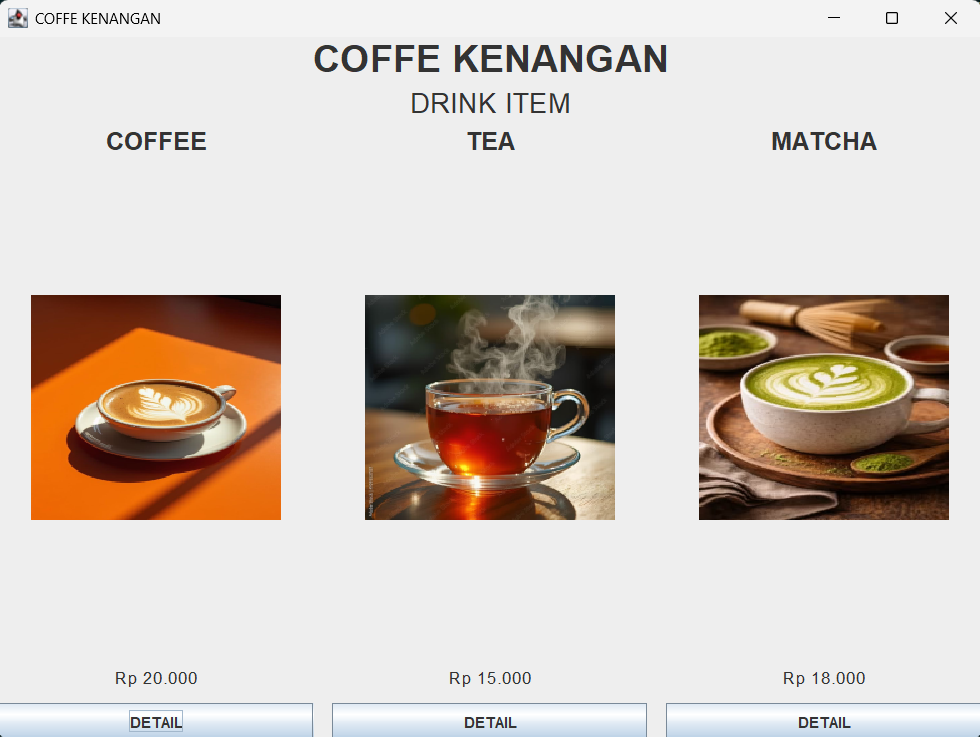
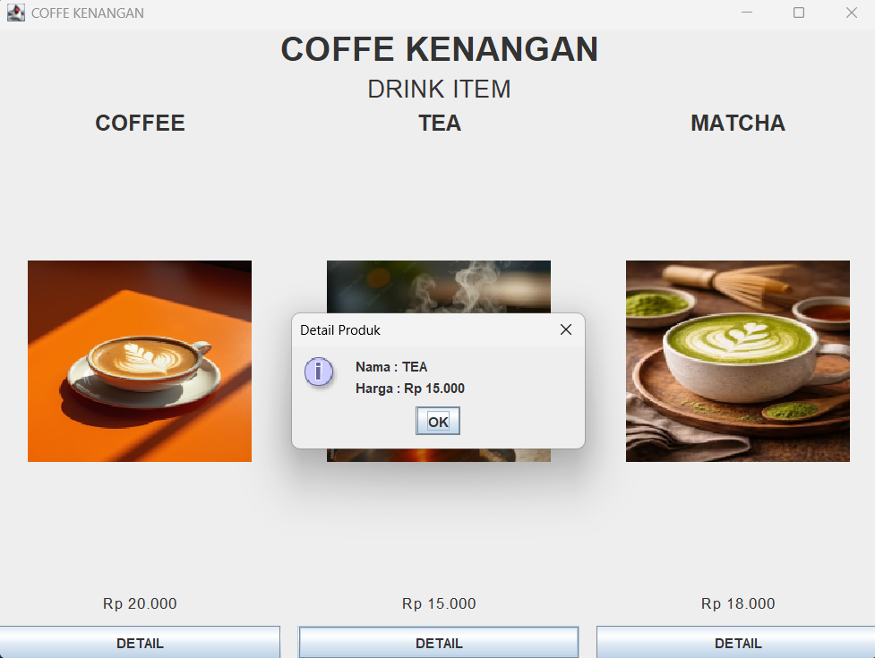

# COFFE KENANGAN

Program GUI sederhana menggunakan Java Swing untuk menampilkan beberapa pilihan DRINK ItEM seperti Coffee, Tea, dan Matcha. Program dibuat menggunakan konsep GUI Java dengan beberapa class Swing dan event listener.

## 5 Komponen Utama GUI

### 1. JFrame

`JFrame` digunakan sebagai Top-level Container, yaitu jendela utama tempat seluruh tampilan aplikasi ditampilkan.

Pada program ini digunakan:

```java
public class Main extends JFrame
```

Dengan `extends JFrame`, class `Main` menjadi sebuah window GUI.

Contoh penggunaannya:

```java
setTitle("COFFE KENANGAN");
setSize(800, 600);
setDefaultCloseOperation(JFrame.EXIT_ON_CLOSE);
```

### 2. JPanel

`JPanel` digunakan sebagai Intermediate Container untuk mengelompokkan beberapa komponen GUI.

Pada program terdapat panel untuk bagian header dan produk:

```java
JPanel header = new JPanel();
JPanel productPanel = new JPanel();
```

`productPanel` digunakan untuk menampung tiga produk, yaitu Coffee, Tea, dan Matcha.

### 3. JLabel

`JLabel` digunakan untuk menampilkan teks dan gambar pada GUI.

Contohnya:

```java
JLabel title = new JLabel("COFFE KENANGAN",SwingConstants.CENTER);
```

Selain teks, `JLabel` juga digunakan untuk menampilkan gambar minuman:

```java
JLabel labelGambar = new JLabel(gambar);
```

### 4. JButton

`JButton` digunakan untuk membuat tombol yang dapat ditekan oleh pengguna.

Pada program ini digunakan tombol:

```java
JButton buttonDetail = new JButton("DETAIL");
```

Ketika tombol ditekan, program akan menampilkan informasi nama dan harga minuman.

### 5. ActionListener

`ActionListener` digunakan untuk menangani **aksi atau event**, khususnya ketika tombol `DETAIL` ditekan.

Contohnya:

```java
buttonDetail.addActionListener(new ActionListener() {
    @Override
    public void actionPerformed(ActionEvent e) {
        JOptionPane.showMessageDialog(DrinkItem.this,"Nama : " + nama + "\nHarga : " + harga,"Detail Produk",JOptionPane.INFORMATION_MESSAGE);
    }
});
```

`actionPerformed()` akan dijalankan ketika pengguna menekan tombol `DETAIL`. Anotasi `@Override` menunjukkan bahwa method tersebut merupakan implementasi method dari interface `ActionListener`.

## Layout yang Digunakan

Program menggunakan dua jenis Layout Class, yaitu:

### BorderLayout

`BorderLayout` digunakan untuk mengatur posisi komponen berdasarkan area seperti `NORTH` dan `CENTER`.

```java
setLayout(new BorderLayout());

add(header, BorderLayout.NORTH);
add(productPanel, BorderLayout.CENTER);
```

### GridLayout

`GridLayout` digunakan untuk menyusun komponen dalam bentuk baris dan kolom.

Contohnya:

```java
productPanel.setLayout(new GridLayout(1, 3, 15, 15));
```


Artinya terdapat 1 baris dan 3 kolom untuk menampilkan tiga produk, dicontoh kode itu juga digunakan grid (2,1,..,..) untuk mengatur label harga dan button untuk detail

## Screenshot Program

### Tampilan Utama


### Detail Produk
